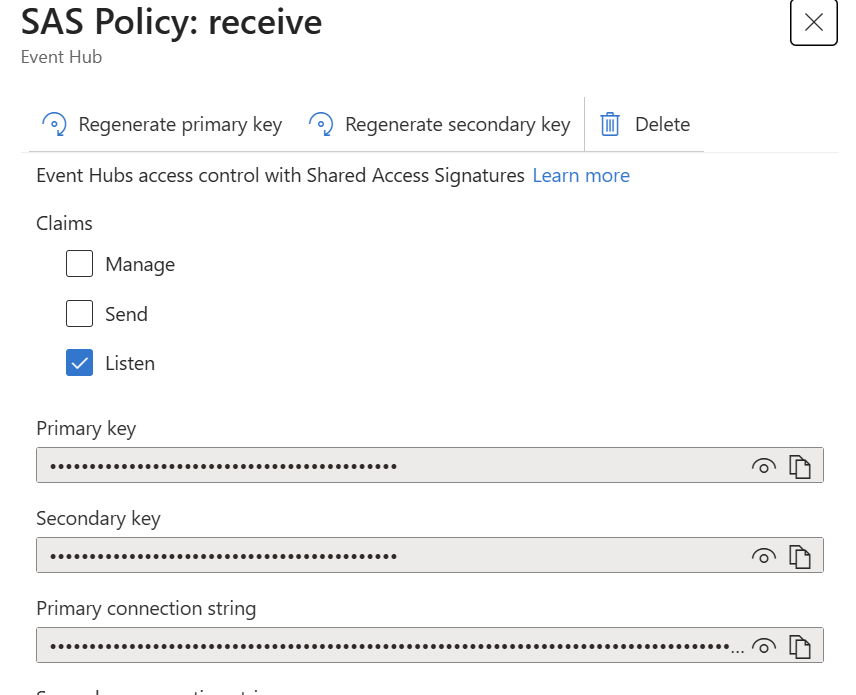
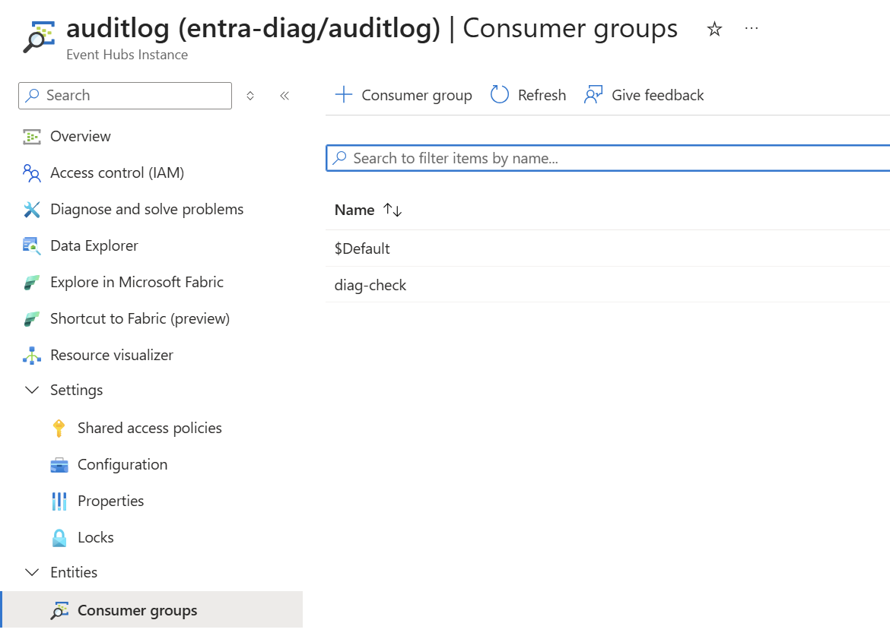
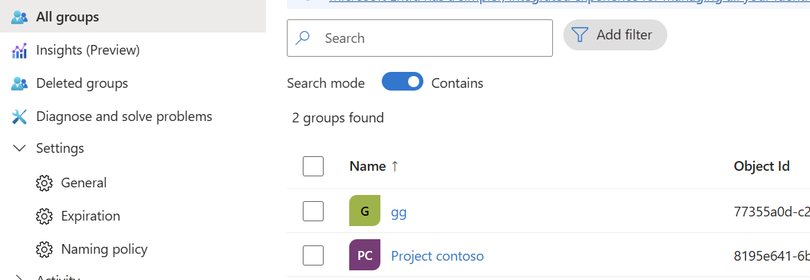
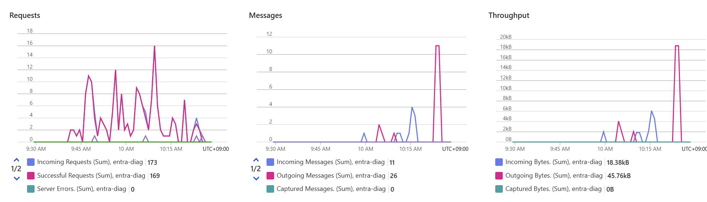
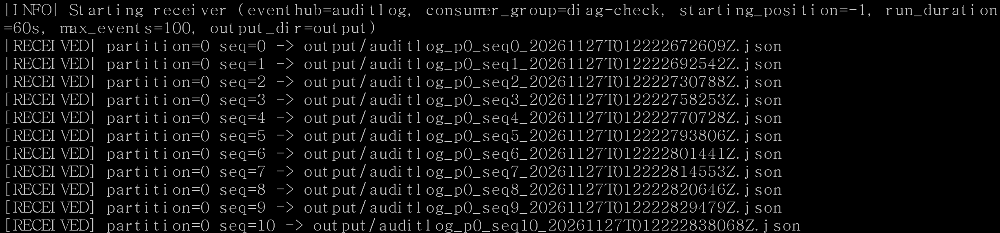

# EventHub에서 Entra Audit 로그 수신 앱 생성/검증 가이드

이 문서는 `entra-diag` 네임스페이스의 `auditlog` Event Hub에서 메시지를 수신해 로컬 JSON 파일로 저장하는 Python 샘플 앱의 구성/검증 절차를 정리한 문서입니다.

---

## 1. Listen 전용 SAS Policy 생성 (Namespace)

Event Hubs Namespace(`entra-diag`)의 **Shared access policies**에서 `receive` 정책을 만들고 **Listen만 체크**합니다.

- 권장 이유: 수신 앱에는 최소 권한(Least Privilege) 적용
- 사용 값: `SharedAccessKeyName=receive`, 해당 `Primary connection string`



> 참고: 진단 설정(Entra -> Event Hub 내보내기)은 별도 정책을 쓸 수 있으나, 수신 앱은 Listen 전용 정책 사용을 권장합니다.

---

## 2. Consumer Group 생성 및 필요 이유

`auditlog` Event Hub에 `diag-check` Consumer Group을 생성했습니다.



### 왜 필요한가?
- Consumer Group은 **읽기 오프셋을 분리**하는 논리 채널입니다.
- `$Default`와 `diag-check`는 같은 메시지를 각각 독립적으로 읽을 수 있습니다.
- 테스트/운영/다른 파이프라인 간 **서로 간섭 없이** 검증할 수 있습니다.

---

## 3. Entra ID에서 이벤트 발생 (테스트 데이터 생성)

Entra ID에서 그룹 생성/삭제를 수행해 Audit 로그를 발생시켰습니다.



테스트에서 확인된 대표 Activity:
- `Add group`
- `Delete group`

---

## 4. Event Hub 수신 확인

메트릭 상에서 Requests뿐 아니라 Messages가 증가하는 것을 확인했습니다.



또한 Data Explorer에서 실제 이벤트 본문(JSON) 수신 확인:
- `category: AuditLogs`
- `operationName: Add group` / `Delete group`

---

## 5. Python 앱 개요 (로직)

파일: `receiver.py`

동작 요약:
1. `.env`에서 연결 정보 로드
2. `EventHubConsumerClient`로 `eventhub_name + consumer_group` 수신
3. 수신 이벤트를 JSON-safe 변환(bytes 키/값 정규화 포함)
4. 이벤트 1건당 파일 1개로 `output/`에 저장
5. `RUN_DURATION_SECONDS` 또는 `MAX_EVENTS` 조건으로 종료

---

## 6. 실행 방법

프로젝트 경로:
`C:\Temp\EventHub\EntraAuditlog_Receiver`

### 6.1 가상환경/패키지 설치
```powershell
cd C:\Temp\EventHub\EntraAuditlog_Receiver
python -m venv .venv
.\.venv\Scripts\Activate.ps1
pip install -r requirements.txt
```

### 6.2 환경변수 파일 준비
```powershell
copy .env.example .env
```

`.env` 예시:
```env
EVENTHUB_CONNECTION_STRING=Endpoint=sb://entra-diag.servicebus.windows.net/;SharedAccessKeyName=receive;SharedAccessKey=...
EVENTHUB_NAME=auditlog
EVENTHUB_CONSUMER_GROUP=diag-check
OUTPUT_DIR=./output
MAX_EVENTS=100
RUN_DURATION_SECONDS=60
MAX_WAIT_TIME_SECONDS=10
STARTING_POSITION=-1
```

### 6.3 실행
```powershell
python receiver.py
```

실행 예:


---

## 7. 실행 결과 요약

`output\` 폴더에 이벤트별 JSON 파일이 생성되었습니다.

- 파일 패턴: `auditlog_p{partition}_seq{sequence}_timestamp.json`
- 확인된 이벤트: `Add group`, `Delete group`, 기타 AuditLogs 이벤트
- 결과: Event Hub -> 로컬 파일 수집 경로 정상 동작

